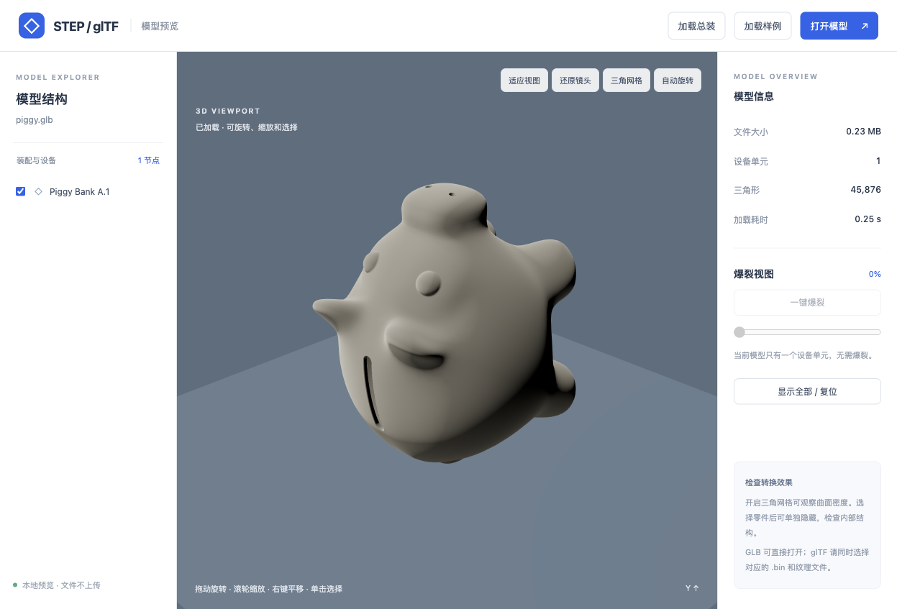
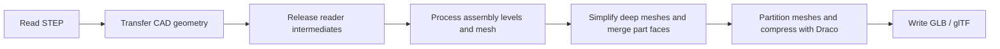

# step-parser

[简体中文](README.md) | English

**A native tool for parsing, simplifying, and converting large industrial STEP models to glTF.**

This package addresses a practical problem: when an industrial assembly reaches hundreds of megabytes or several gigabytes in STEP format, geometry conversion and meshing become slow and memory-intensive. The exported model can still be too large to load and interact with smoothly in a browser.

`step-parser` handles that pipeline in a native C++ converter. It merges assemblies, simplifies meshes, and compresses the output while producing a model for visualization. The frontend loads the resulting GLB and retains device-level selection, visibility controls, and explosion of one assembly level.

The repository is named `step-parser`; the executable is still named **`step2gltf`**.



Actual viewer rendering of the included `samples/piggy.step` sample after conversion to GLB. This sample contains a single part.

## Why this package exists

Industrial STEP files describe CAD geometry and product structure. A browser needs triangle meshes. Converting between them requires file reading, geometry transfer, meshing, and export. A successful conversion does not necessarily mean the conversion was efficient or its output is suitable for the web.

Large assemblies exposed three related problems:

- **Conversion time and memory pressure.** STEP intermediate data, CAD geometry, and triangle meshes can coexist during conversion. Processing these inputs in a browser also runs into runtime and memory constraints.
- **Heavy output.** A full export may contain tens of millions of triangles and produce a GLB hundreds of megabytes in size, increasing download, decoding, GPU memory, and rendering costs.
- **More detail than the interaction requires.** Web applications often need to inspect an assembly, select or hide devices, and spread them apart. They do not necessarily need independent interaction with every internal bolt or small part.

Further tuning of global `--linear` and `--angular` settings alone cannot easily satisfy appearance, size, and interaction requirements together. This package preserves the device hierarchy needed for viewing and reduces deeper detail during conversion, before it adds unnecessary mesh and node overhead downstream.

## How it works

With `--preview`, the complete pipeline runs inside `step2gltf`:



| Optimization | Purpose |
| --- | --- |
| Native C++ / OCCT conversion | Process STEP and CAD geometry outside the browser; deliver a visualization model to the frontend |
| Earlier release of intermediate data | Release STEP reader entities and transfer maps after geometry transfer, then close the source document once the preview is ready, reducing memory overlap between stages |
| Detail based on assembly depth | Merge level 3 and deeper geometry into its level-2 device and mesh it directly at lower detail, avoiding a full-detail mesh of that geometry first |
| Parallel meshing and meshoptimizer simplification | Use parallel meshing and further reduce deep-device triangles within a relative error limit |
| Face merging within a part | Reduce drawing units inside each device while preserving device nodes |
| Mesh partitioning and Draco compression | Reduce output size and limit the decoding burden of individual compressed meshes |
| Per-stage timing | Use `-v` to distinguish STEP reading, geometry transfer, reader release, meshing, and export costs |

There is no requirement to export a large full-detail GLB first or run a Node.js compression script afterward. The browser handles decoding, rendering, and interaction.

These optimizations affect different stages: **Draco primarily reduces file size, simplification reduces mesh and rendering costs, and earlier data release reduces memory overlap. They do not imply an equivalent speedup in STEP reading itself.** The reader still loads source CAD data; this is not a streaming, constant-memory parser.

## What is preserved and what is reduced

Preview mode targets device-level interaction:

- The STEP root assembly is level 1; its direct devices are level 2. Devices remain independently selectable, hideable, and movable in an exploded view.
- Parts at level 3 and deeper are merged into their owning device and move with it.
- Device names, placements, model units, and device-level colors are retained. Merging discards the full descendant naming structure, individual descendant interaction, and some descendant color information.
- Deep simplification can remove small details. The default target retains approximately 15% of deep triangles, but the error limit may require retaining more.

This is intended for web visualization, equipment review, and assembly browsing. Keep the original STEP data for precision measurement, manufacturing, or full CAD editing.

**A STEP file without assembly relationships does not automatically gain a device hierarchy.** A single product may contain many geometric solids, but that does not activate the current deep-assembly merging and simplification rules or provide device-level explosion.

## Measured results

These results come from industrial-model tests on one development machine. Sizes use decimal MB / GB. The industrial inputs and complete benchmark artifacts are not distributed with the repository.

| Model | STEP input | Baseline GLB | Optimized GLB | Triangles: baseline → optimized | Retained devices |
| --- | ---: | ---: | ---: | ---: | ---: |
| Main assembly (`总装`) | Approx. 0.99 GB | 734.25 MB | **17.72 MB** | 57,135,212 → **2,111,647** | 28 |
| 2302-FT-3301 | Approx. 2.08 GB | 824.34 MB | **110.11 MB** | 27,191,590 → 27,182,990 | 1 |

The main assembly has a hierarchy, allowing deeper devices to be merged and simplified. The 2302 model has no assembly hierarchy and retains shallow mesh detail; its size reduction comes mainly from face merging and Draco compression. It illustrates that **a smaller file and fewer triangles are different outcomes**.

In an earlier paired test with the same viewer and HTTP caching disabled, a 72.36 MB intermediate assembly version loaded in 5.77 seconds, while the simplified 17.72 MB version loaded in 1.28 seconds. The simplified version rendered at approximately 60 FPS during rotation. These were local browser measurements at that time, not guarantees for other networks, devices, or later rendering configurations.

A single conversion of the 2.08 GB model after the intermediate-data lifetime change took approximately **8 minutes 13 seconds**, including 4 minutes 16 seconds for CAD geometry transfer and 2 minutes 47 seconds for meshing. Previous runs of the same input ranged from approximately 6 to 25 minutes under uncontrolled load; these results do not establish a fixed speedup attributable to the code change.

The current output-size target is **under 300 MB**, but the program does not guarantee that limit for every input or provide an automatic size-budget option. The test inputs also produced unresolved STEP reference warnings; successful export does not establish geometric completeness.

## Getting started

See the **[cross-platform build and usage guide (Chinese)](docs/build-and-usage.zh-CN.md)** for full macOS, native Windows, WSL, and Linux instructions.

macOS Apple Silicon has been verified through compilation, regression checks, and real-model conversion. The documented instructions for other platforms still need testing on those platforms. Core dependencies are C++17, OCCT 7.9.3, meshoptimizer 0.25, Draco 1.5.7, and RapidJSON.

For a first build on macOS, install Xcode Command Line Tools, then run:

```bash
bash scripts/setup-macos.sh
make check
```

Run the following commands from the repository root. If you already have a working build, start with conversion; rebuilding is not required for each model.

Convert the included sample:

```bash
./step2gltf --preview -v samples/piggy.step .local-build/piggy.glb
```

Convert your own assembly:

```bash
mkdir -p .local-build/models
./step2gltf --preview -v /path/to/assembly.STEP .local-build/models/assembly-web.glb
```

Replace `/path/to/assembly.STEP` with your input path and quote paths containing spaces. A successful conversion exits with code `0`; the final argument specifies the output location. `-v` reports time spent reading, transferring geometry, releasing the reader, meshing, and exporting.

After a native Windows build, use `./step2gltf.exe`. For example, in PowerShell:

```powershell
New-Item -ItemType Directory -Force .local-build/models | Out-Null
./step2gltf.exe --preview -v "C:/models/assembly.STEP" .local-build/models/assembly-web.glb
```

The `.glb` extension packages JSON and geometry buffers into one file. A `.gltf` export uses associated external binary resources that must be delivered alongside it. Your application can manage textures and replace materials after loading; the converter currently retains basic material/color information.

### Common options

| Option | Default | Purpose |
| --- | --- | --- |
| `--encoding` | `GBK` | STEP source name encoding; use `--encoding=UTF-8` for UTF-8 input. GLB names remain Unicode. |
| `--preview` | Off | Enable device-level preview merging, deep simplification, and Draco compression |
| `--linear` / `--angular` | `0.1` / `0.5` | Mesh precision for shallow parts or ordinary export |
| `--deep-linear` / `--deep-angular` | `1.0` / `0.8` | Initial mesh precision for deep devices |
| `--deep-ratio` | `0.15` | Target fraction of deep triangles to retain; `1` disables simplification while retaining merging and compression |
| `--deep-error` | `0.001` | Relative error limit for deep simplification |
| `-v` | Off | Print per-stage timings |

Use `--name=value` for numeric arguments, such as `--deep-ratio=0.3`, and place options before the input and output paths. All `--deep-*` options require `--preview`. Linear deflection uses OCCT model units; angular deflection uses radians. Parameter ranges are documented in the build and usage guide.

For example, increase the target ratio to retain more deep triangles, still subject to the error limit:

```bash
./step2gltf --preview --deep-ratio=0.3 --deep-error=0.001 -v /path/to/assembly.STEP .local-build/models/assembly-web.glb
```

To produce textual glTF, change the output extension to `.gltf`:

```bash
./step2gltf --preview -v samples/piggy.step .local-build/piggy.gltf
```

Without `--preview`, the converter preserves the complete assembly hierarchy and does not enable deep simplification or Draco compression. It still merges faces within each part.

## Inspecting the result

The repository includes a standalone Three.js viewer for checking output quality and device interactions. Install its dependencies and start the local server:

```bash
npm ci --prefix viewer
npm run dev --prefix viewer
```

Open the [assembly viewer](http://127.0.0.1:8086/viewer/), which loads `.local-build/models/assembly-web.glb` by default. If you converted the included sample, open the [sample viewer](http://127.0.0.1:8086/viewer/?model=../.local-build/piggy.glb) or click **加载样例** (Load sample). You can also use **打开模型** (Open model) to select local files. For `.gltf`, include its referenced `.bin` and texture files in the selection.

The viewer supports rotation, zoom, device selection and hiding, yellow highlighting, focus on selection, single-level explosion, and restoration. Its lighting, highlighting, and staggered X-axis explosion logic were ported from the `engine-checker-fe` `3DModel` component. Running this viewer does not require the business frontend or its backend services.

On native Windows, if `python3` is unavailable, run `py -3 -m http.server 8086 --bind 127.0.0.1 --directory .` from the repository root to start the same server.

`piggy.step` is a single-part sample with no assembly structure to explode. Compressed outputs require Draco support in the browser loader; the included viewer already configures the decoder.

## Development and validation

```bash
make release
make check
npm run check --prefix viewer
```

The native checks cover assembly hierarchy, shared geometry, colors, units, placements, and a Draco export/decode round trip. Viewer checks cover axis-based movement, transformed parents, animation completion, exact position restoration, and material restoration.

| Path | Contents |
| --- | --- |
| [main.cpp](main.cpp) | CLI entry point, STEP conversion, data lifetime management, and glTF export |
| [preview.hxx](preview.hxx) | Assembly preview processing, mesh simplification, and partitioning |
| [scripts/](scripts/) | Local build script and OCCT Draco patch |
| [tests/](tests/) | Native conversion regression checks |
| [viewer/](viewer/) | Browser preview and interaction checks |
| [docs/](docs/) | Cross-platform build and usage documentation |

Build dependencies and conversion artifacts are stored in `.local-build/` and excluded from Git. Rebuild for each platform and CPU architecture rather than reusing incompatible binaries.

## License

This repository uses the [MIT License](LICENSE). Dependencies such as OCCT, Draco, and meshoptimizer retain their respective licenses.
